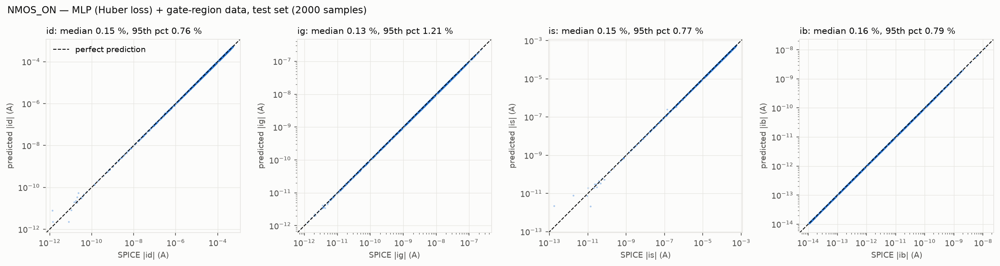
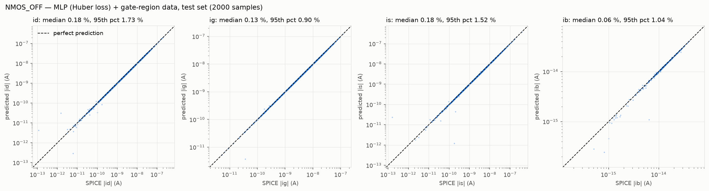

# ML models — single-transistor leakage

Four models, one per case (NMOS ON, NMOS OFF, PMOS ON, PMOS OFF), each predicting the four terminal currents
`id, ig, is, ib` of one transistor from the operating point and the process parameters.
Model file `45nm_MGK.pm`, nominal VDD 0.9 V, seed `12175305`, 20,000 samples per case (see
[`../Data_Generation/README.md`](../Data_Generation/README.md)).

## Result summary (test set, 2,000 samples per case, average over the four currents)

| Case | Final model | R² (log\|I\|) | Median error | 95th pct error | Mean error |
|---|---|---|---|---|---|
| NMOS_ON | MLP 128-64-32-16, Huber loss, + gate-region rows | 0.9997 | **0.15 %** | **0.88 %** | 0.63 % |
| NMOS_OFF | MLP 128-64-32-16, Huber loss, + gate-region rows | 0.9887 | **0.14 %** | **1.30 %** | 3.07 % ¹ |
| PMOS_ON | MLP 128-64-32-16, Huber loss, + gate-region rows | 0.9997 | **0.14 %** | **0.79 %** | 0.41 % |
| PMOS_OFF | MLP 128-64-32-16, Huber loss, + gate-region rows | 0.9959 | **0.14 %** | **1.15 %** | 1.13 % |

Error = |I_pred / I_SPICE − 1| × 100 for each sample and current (current magnitudes). The test set was used only once, in
[`Results/model_evaluation.ipynb`](Results/model_evaluation.ipynb), after all choices were made on the validation set.

* **Typical accuracy is the same for NMOS and PMOS:** median ≤ 0.15 % and 95th percentile ≤ 1.0 % in all four cases.
* ¹ **The NMOS_OFF mean is dominated by a few rows** (see [below](#why-the-nmos_off-mean-error-is-high-while-its-median-is-not)):
  the 5 worst of 2,000 test rows account for 82 % of the mean error of `id` and 94 % of that of `is`; without them the mean
  errors are 0.61 % (`id`) and 0.51 % (`is`). The mean is therefore not a reliable measure of NMOS_OFF accuracy.
* **How the final model was found:** the training notebooks compared five model types with the MSE loss (the MLP won by
  about 10× in median error); a follow-up study then trained the same MLP with a Huber loss, which is better on the
  validation median and 95th percentile in every case. All four models were finally re-trained with 4,000 extra rows from the
  region where the transistor operates inside gates, where Part B showed their errors ([Final models](#final-models)): the ON
  models first, the OFF models after the gate-level diagnostic showed that the remaining error sat in the OFF channel currents.
* Transistor-level accuracy here; gate level (Part B): median 0.17 %, mean accuracy 99.77 %, see
  [`../Gate_Validation/README.md`](../Gate_Validation/README.md).

Per current, test set (median / 95th percentile / mean error in %):

| Current | NMOS_ON | NMOS_OFF | PMOS_ON | PMOS_OFF |
|---|---|---|---|---|
| `id` | 0.15 / 0.76 / 0.72 | 0.18 / 1.73 / 3.49 | 0.13 / 0.72 / 0.76 | 0.19 / 1.51 / 2.90 |
| `ig` | 0.13 / 1.21 / 0.34 | 0.13 / 0.90 / 0.33 | 0.14 / 1.00 / 0.28 | 0.12 / 1.09 / 0.39 |
| `is` | 0.15 / 0.77 / 1.22 | 0.18 / 1.52 / 8.00 | 0.13 / 0.69 / 0.33 | 0.17 / 1.33 / 0.80 |
| `ib` | 0.16 / 0.79 / 0.24 | 0.06 / 1.04 / 0.46 | 0.17 / 0.75 / 0.26 | 0.08 / 0.70 / 0.45 |
| average | 0.15 / 0.88 / 0.63 | 0.14 / 1.30 / 3.07 | 0.14 / 0.79 / 0.41 | 0.14 / 1.15 / 1.13 |

Full table: [`Results/test_results.csv`](Results/test_results.csv). Predicted-vs-SPICE plots (test set, log axes):
[NMOS_ON](Plots/parity_NMOS_ON.png), [NMOS_OFF](Plots/parity_NMOS_OFF.png), [PMOS_ON](Plots/parity_PMOS_ON.png),
[PMOS_OFF](Plots/parity_PMOS_OFF.png).




## Method (identical for all four cases)

| Step | Choice |
|---|---|
| Data | 20,000 rows per case: rows 1 – 10,000 are the original 10k dataset, rows 10,001 – 20,000 continue the same seed |
| Split | random 80 / 10 / 10 → 16,000 train / 2,000 validation / 2,000 test, `train_test_split(random_state=12175305)`; one split of the row indices shared by all models of a case |
| Inputs | 10 raw (`vdd, temp, w, vd, vs, vth0, toxe, ndep, u0, xj`) + 15 physics features = 25. `vg` and `vb` are constant or equal to `vdd`, so they are not features |
| Physics features | terminal differences (`vgs, vgd, vds, vbs, vbd`); effective source (for NMOS the lower of `vd` / `vs`): `vgs_eff, vbs_eff, vds_abs`; sub-threshold terms `overdrive_vt = (vgs_eff − \|vth0\|)/Vt`, `log(1 − exp(−\|vds\|/Vt))`, `1/T`, `log w`; gate-tunnelling terms `1/toxe, vgs/toxe, vgd/toxe` |
| Targets | `log10 \|I\|` of `id, ig, is, ib` (each current spans 3 – 10 decades). The sign is not learned; `LeakageModel.predict_signed` adds it with a rule (see [Current signs](#current-signs-predict_signed-for-parts-b-and-c)) |
| Scaling | `StandardScaler` fitted on the training rows only (inputs; targets too for the MLP) |
| Selection | per case, the model with the lowest **validation median and 95th-percentile error** (average over the four currents). The training notebooks first chose by the validation mean; that mean is decided by a few near-cancelled rows, so it is reported but not used for the final choice |
| Test | the final model is evaluated once, on the test rows |

Model types compared (all four currents predicted at once):

| Model | Main settings |
|---|---|
| Random forest | 300 trees, `max_features=0.5`, `min_samples_leaf=1` |
| XGBoost | `learning_rate=0.05`, `max_depth=4`, `subsample=0.8`, `colsample_bytree=0.8`, up to 10,000 trees with early stopping (200 rounds) |
| Polynomial regression | polynomial features of the standardized inputs → `StandardScaler` → Ridge; degree 1 – 3 and alpha 1e-4 / 1e-2 / 1 / 100 searched on the validation set (best: degree 3, alpha 0.01 for both NMOS cases) |
| MLP | 25 → 128 → 64 → 32 → (16 or 32) → 4, SiLU, MSE on the standardized log targets, AdamW (lr 0.01, weight decay 1e-4), batch 256, learning rate halved after 50 epochs without validation improvement, early stopping after 300 epochs, at most 3,000 epochs; last hidden layer (16 / 32) chosen per case on the validation median error |
| MLP + Kirchhoff loss | the MLP above plus λ · mean[(Σ s_k·\|Î_k\| / Σ \|Î_k\|)²], which penalizes violations of `id + ig + is + ib = 0` using the true signs s_k during training; λ ∈ {10, 30, 100} chosen on the validation mean error |
| **MLP (Huber loss)** — the model of the follow-up study (the OFF models of Part A until the gate-region rows) | the MLP 128-64-32-16 with a Huber (smooth-L1) loss instead of MSE, transition width β = 0.002 in standardized units (chosen on validation from 0.002 – 0.2), 3,000 epochs without early stopping (the epoch with the lowest validation loss is kept), two training seeds per case, the one with the lower validation median kept. Trained by `Scripts/run_offstudy.py --stage 13`, installed by `Scripts/export_huber_models.py` |
| **MLP (Huber loss) + gate-region data** — final for all four cases | the same recipe trained on the 16,000 training rows + 80 % of the 4,000 gate-region rows (`Data_Generation/Datasets/*_gate_region.csv`; ON: both terminals near a rail, \|Vds\| down to 0.1 µV; OFF: drain and source at opposite rails, at the same rail, or one at a rail and one at a stack node); in gate-region rows with \|Vds\| < 10 mV, `id` / `is` are left out of the loss (the gate composition takes that channel current from Kirchhoff's law). Validation = the 2,000 validation rows + 10 % of the gate-region rows; two seeds, the lower sum of the two validation medians kept. `Scripts/train_on_models_gate_region.py` |

The NMOS settings were **carried over from the PMOS study unchanged** (features, split, hyper-parameters, selection rule). Only
the choices that the training notebook itself makes on validation data were made again on NMOS data.

## Model comparison (validation set, 2,000 samples per case)

Each cell: R² (log\|I\|) / median / 95th percentile / mean error in %, averaged over the four currents.
Per-current values: [`Results/validation_comparison_NMOS.csv`](Results/validation_comparison_NMOS.csv),
[`Results/validation_comparison_PMOS.csv`](Results/validation_comparison_PMOS.csv).

| Model | NMOS_ON | NMOS_OFF | PMOS_ON | PMOS_OFF |
|---|---|---|---|---|
| Random forest | 0.9882 / 14.34 / 56.09 / 23.44 | 0.9199 / 10.16 / 47.46 / 201.05 | 0.9877 / 14.21 / 54.42 / 20.32 | 0.9226 / 9.75 / 49.83 / 29.17 |
| XGBoost | 0.9986 / 3.14 / 14.42 / 5.55 | 0.9818 / 3.45 / 20.70 / 69.06 | 0.9989 / 2.86 / 12.61 / 4.37 | 0.9851 / 3.33 / 19.42 / 13.43 |
| Polynomial (Ridge) | 0.9958 / 5.79 / 27.96 / 9.20 | 0.8692 / 13.67 / 67.03 / 244.18 | 0.9968 / 4.46 / 22.10 / 7.02 | 0.8683 / 14.59 / 77.30 / 69.96 |
| MLP | 0.9999 / 0.24 / 1.30 / **0.54** | 0.9763 / 0.40 / 2.96 / 8.52 | 1.0000 / 0.34 / 1.62 / 0.56 | 0.9897 / 0.33 / 2.02 / 1.83 |
| MLP + Kirchhoff loss | 0.9996 / 0.60 / 3.16 / 1.34 | 0.9903 / 0.41 / 2.83 / 7.25 | 0.9999 / 0.43 / 2.15 / 0.76 | 0.9915 / 0.35 / 2.25 / 1.50 |
| **MLP (Huber loss)** | 0.9997 / **0.10** / **0.66** / 0.57 | 0.9916 / **0.12** / **1.02** / **4.71** | 1.0000 / **0.09** / **0.62** / **0.22** | 0.9954 / **0.12** / **0.86** / **0.84** |
| **MLP (Huber loss) + gate-region data** | 0.9998 / 0.15 / 0.89 / **0.51** | 0.9924 / 0.13 / 1.18 / 6.14 | 0.9999 / 0.14 / 0.86 / 0.29 | 0.9960 / 0.14 / 1.09 / 0.98 |

Bold: best median / 95th percentile / mean in the column. The MLP is ahead of every other model type by roughly an order of
magnitude in median error in all four cases (e.g. NMOS_ON 0.24 % vs 3.14 % for the next best, XGBoost), and the Huber loss
lowers its median a further 2.3 – 3.7× and its 95th percentile 2.0 – 2.9×. The Huber rows come from
[`Results/validation_comparison_HUBER.csv`](Results/validation_comparison_HUBER.csv) (written by `Scripts/export_huber_models.py`) and [`Results/validation_comparison_GATE_REGION.csv`](Results/validation_comparison_GATE_REGION.csv)
(`Scripts/train_on_models_gate_region.py`). Final models: the gate-region version in all four cases
(next section: on these uniformly sampled rows it is 0.01 – 0.05 points worse in median, on the gate operating region much better).

NMOS choices made on the validation set inside the training notebook (MSE loss; superseded by the Huber MLP):

| | NMOS_ON | NMOS_OFF |
|---|---|---|
| Last hidden layer 16 / 32 (val. median, 95th) | 0.39 %, 1.69 % / **0.24 %, 1.30 %** | **0.40 %, 2.96 %** / 0.85 %, 4.88 % |
| λ = 10 / 30 / 100 (val. mean, median) | 1.58 % / **1.34 %** / 3.59 % (0.81 / 0.60 / 1.98 %) | **7.25 %** / 8.61 % / 22.84 % (0.41 / 0.65 / 4.37 %) |
| Notebook's pick | plain MLP (the Kirchhoff term hurts for every λ) | MLP + Kirchhoff, λ = 10 |

The Kirchhoff term works as intended — the predictions obey `id + ig + is + ib = 0` 4.7× (ON) and 7.5× (OFF) better
(median relative residual 4.2e-4 → 8.9e-5 and 1.7e-3 → 2.2e-4) — but it only helps the *mean* of an OFF case.

## Final models

| File | Model | Parameters | Training seed | Validation median / 95th / mean | Test median / 95th / mean |
|---|---|---|---|---|---|
| `Saved_Models/NMOS_ON.pt` | MLP 128-64-32-16, Huber loss β = 0.002, + gate-region rows | 14,260 | 12175306 | 0.15 / 0.89 / 0.51 % | 0.15 / 0.88 / 0.63 % |
| `Saved_Models/NMOS_OFF.pt` | MLP 128-64-32-16, Huber loss β = 0.002, + gate-region rows | 14,260 | 12175305 | 0.13 / 1.18 / 6.14 % | 0.14 / 1.30 / 3.07 % |
| `Saved_Models/PMOS_ON.pt` | MLP 128-64-32-16, Huber loss β = 0.002, + gate-region rows | 14,260 | 12175306 | 0.14 / 0.86 / 0.29 % | 0.14 / 0.79 / 0.41 % |
| `Saved_Models/PMOS_OFF.pt` | MLP 128-64-32-16, Huber loss β = 0.002, + gate-region rows | 14,260 | 12175306 | 0.14 / 1.09 / 0.98 % | 0.14 / 1.15 / 1.13 % |

Validation and test on the 2,000 + 2,000 uniformly sampled rows of the 80 / 10 / 10 split (seed 12175305, the same for every
model). All four were trained for 3,000 epochs. Each file is self-contained: weights, hidden layers, feature list, both scalers,
dataset name(s), training seed, split seed, loss and the validation errors recorded when it was trained. The evaluation notebook
recomputes the validation error from every file and checks that it equals the recorded value (it does, for all four).

**Why the Huber loss and not the notebooks' first choice.** The training notebooks chose by the validation *mean*: the plain MLP for
the ON cases and the MLP + Kirchhoff loss for the OFF cases (validation median 0.24 / 0.41 / 0.34 / 0.35 %, 95th percentile 1.30 /
2.83 / 1.62 / 2.25 %). The mean, however, is decided by a few near-cancelled rows (next section), so it does not separate the
models' typical accuracy. On the validation median and 95th percentile — the metrics of deliverables 4 and 5 — the Huber MLP is
better in all four cases. Those earlier models remain in the git history (commit 603bc8b); re-running a training notebook saves its
pick to `Saved_Models/notebook_mse/` (ignored by git) and does not touch the final models.

**Why the ON models learn from gate-region rows.** Inside a gate an ON transistor has both terminals near one rail and a |Vds|
of 20 µV – 1 mV. Uniform sampling of vd / vs puts 0.2 % of the rows there, and Part B found that the ON models' gate and body
currents (`ig`, `ib`) — the currents its Kirchhoff composition takes from the model — were 2 – 7 % off inside gates and set most of
the gate-level error. `Data_Generation/Scripts/generate_gate_region_data.py` adds 4,000 single-transistor rows per ON case in that
region (own random draws, no gate result). On the gate-region validation rows (`Results/gate_region/runs/`) the new ON models cut the
tail of `ig` / `ib` from a 95th percentile of 1,400 – 1,700 % / 29 – 98 % (Huber models) to 31 – 32 % / 2.0 – 2.9 % (the remaining
large `ig` errors are rows where the gate current itself is tiny), with medians 0.28 – 0.30 % instead of 0.37 – 0.52 %. On the uniformly
sampled rows they cost about 0.05 points of median error (0.10 → 0.15 % NMOS_ON, 0.09 → 0.14 % PMOS_ON; 95th percentile 0.62 → 0.88 % and
0.60 → 0.79 %). At gate level the median error falls from 1.42 % to 0.34 % and the mean accuracy rises from 97.7 % to 99.5 %
([Part B](../Gate_Validation/README.md)). A wider network (256-128-64-32) was also tried; its validation score was within the
seed-to-seed spread, so the 128-64-32-16 network was kept.

**Why the OFF models learn from gate-region rows too.** With the ON models fixed, a diagnostic on 12 corners of the gate runs (every
transistor re-simulated alone at the voltages it sees in the gate; [`Gate_Validation/README.md`](../Gate_Validation/README.md))
swapped each group of model currents for the true ones and recomposed the gate leakage: the channel currents (`id`, `is`) of the OFF
transistors at |Vds| > 0.1 V carried most of the remaining error (median 0.41 % → 0.12 % when they were exact), while OFF
transistors at small |Vds| (0.41 % → 0.38 %) and the `ig` / `ib` of OFF transistors (0.39 %) did not matter. Gates place their OFF
transistors at the corner of the (vd, vs) square: of the 8,400 OFF-transistor instances in the 18 gate cases × 200 corners 52 % have
drain and source at opposite rails (|Vds| = VDD), 19 % both at the same rail and 29 % one at a rail and one at a series-stack
node, while the 20,000 uniform rows have about 8 rows within 2 % of VDD of the opposite-rail corner. 4,000 single-transistor rows per
OFF case from those cells (45 / 20 / 20 / 15 % opposite rails / same rail / source at a rail / drain at a rail; drawn for NMOS_OFF and
mirrored for PMOS_OFF; own random draws, no gate result; `generate_gate_region_data.py --cases OFF`) were added with the same
recipe as for the ON models. On 800 / 783 held-out gate-region rows (validation + test part of the 4,000, same filter and loss mask) the
old and new OFF models compare as follows (`id` / `is` median and 95th percentile of the error in %, rows with |vd − vs| ≥ 10 mV):

| | `id` old → new | `is` old → new |
|---|---|---|
| NMOS_OFF | 0.43 / 3.81 → 0.20 / 1.01 | 0.61 / 4.28 → 0.23 / 1.19 |
| PMOS_OFF | 0.37 / 2.27 → 0.20 / 1.03 | 0.53 / 2.71 → 0.23 / 1.45 |

On the uniformly sampled test rows the new OFF models are slightly worse: median 0.13 → 0.14 % (NMOS_OFF) and 0.12 → 0.14 % (PMOS_OFF),
95th percentile 0.99 → 1.30 % and 0.86 → 1.15 %. The NMOS_OFF test mean falls from 5.73 % to 3.07 % and the PMOS_OFF mean rises from
0.85 % to 1.13 %; both are set by 1 – 5 near-cancelled rows (below), whose position relative to the zero crossing changes with every
retraining, so neither number says much about typical accuracy. At gate level the median error falls from 0.34 % to 0.17 %, the 95th
percentile from 1.64 % to 0.63 % and the mean accuracy rises from 99.47 % to 99.77 %. Of the two trained seeds per case the one with the
lower sum of the validation and gate-region validation medians is kept (NMOS_OFF 12175305, PMOS_OFF 12175306); the other seed of
each case was within 0.08 points of median error on the uniform rows (NMOS_OFF test median 0.14 / 0.21 %, PMOS_OFF 0.14 / 0.20 %).
The OFF extra rows were not part of the first version of Part B or of the 4-seed cluster check below; the Huber models of the
follow-up study (without gate-region rows) are the ones in `Results/huber_test_results.csv`, `Results/offstudy/final/` and the cluster runs.

## Why the NMOS_OFF mean error is high while its median is not

`id` and `is` of an OFF transistor are differences between opposite-signed terms (channel leakage, gate / junction leakage).
In NMOS_OFF 15 % of the `id` values are positive and 85 % negative, so the signed current crosses zero inside the sampled
space. Near a crossing |I| becomes tiny and `log10 |I|` dives; the smooth MLP (typical error ≈ 0.1 %) cannot follow a
dip that deep, and the percentage error of such a row is huge. [`Results/model_evaluation.ipynb`](Results/model_evaluation.ipynb)
(section 5, table [`Results/error_concentration.csv`](Results/error_concentration.csv)) quantifies this for the final models:

* **Concentration (test set):** the 5 worst rows (0.25 % of the rows) cause 82 % of the NMOS_OFF `id` mean (3.5 % → 0.61 % without them) and
  94 % of the `is` mean (8.0 % → 0.51 %); a single `is` row (dataset row 13855: 1.6e-13 A next to 5.3e-9 A, error 1.5e4 %) contributes 7.4
  points. PMOS_OFF: 79 % (`id`) and 26 % (`is`). On the validation set the NMOS_OFF outlier is in `id` (mean 23.0 %), on the test set in `is`.
* **Dose-response (held-out rows, `id` and `is`, mean error by current size relative to the largest current of the sample):**

| \|I\| / largest current | 10 – 100 % | 1 – 10 % | 0.1 – 1 % | < 0.1 % |
|---|---|---|---|---|
| NMOS_OFF: pairs / mean error | 7,063 / 0.45 % | 859 / 3.5 % ² | 68 / ≈ 30 % | 10 / ≈ 6,200 % |
| PMOS_OFF: pairs / mean error | 7,299 / 0.41 % | 637 / 1.8 % | 51 / ≈ 30 % | 13 / ≈ 610 % |

  ² One row (|id| = 1.5e-12 A, 3.9 % of its row's largest current) has an error of 1.96e3 % and contributes 2.3 of these 3.5 points.

  NMOS_ON and PMOS_ON have no pair below 1 %; their few large errors (up to 1,150 %) are at samples with vd ≈ vs close to the gate
  voltage, where the transistor barely conducts and all four currents are tiny (largest 1e-12 – 1e-10 A).
* **NMOS_OFF has deeper dips than PMOS_OFF** (smallest |id| 2.9e-15 A vs 4.7e-14 A; worst error 1.5e4 % vs 4.0e3 %), hence its larger mean.
* **At the worst rows the SPICE data is uncertain at the percent level:** its own Kirchhoff residual is 1.9 % and 4.9 % of the two worst
  NMOS_OFF targets. One PMOS_OFF `ib` row (3.0e-16 A) has a residual about nine times its value, i.e. at the solver's numerical floor.
* No rows were removed from the datasets. Median and 95th percentile are the robust measures of typical accuracy; the
  ampere-weighted error Σ|I_pred − I_true| / Σ|I_true| of the NMOS_OFF model before the gate-region rows is 0.35 %.

## Follow-up study: NMOS_OFF error, structured splits and a better loss

Questions: why is the NMOS_OFF mean error high, what is it in amperes, can it be lowered, and how do the models behave on widths and temperatures that were not in training? Written up for the report in
[`../Report/error_analysis_NMOS_OFF.md`](../Report/error_analysis_NMOS_OFF.md); every number is reproduced by [`Results/nmos_off_study.ipynb`](Results/nmos_off_study.ipynb) from the runs in `Results/offstudy/`
(trained by `Scripts/run_offstudy.py`, library `Scripts/offstudy.py`; stages are documented in the script header).

| Finding | Result |
|---|---|
| Why the mean is high | `id` / `is` at the lower-potential terminal are the difference of the channel current and the gate / junction leakage; where they nearly cancel (1.2 % of the values) the absolute error stays at 0.04 – 0.26 % of the row's largest current, so the percentage explodes. Median error is 0.47 % – 0.65 % in every temperature, width, vth0 and VDD bin |
| The mean is unstable | bootstrap of the NMOS_OFF `id` mean over test-size samples: 2.0 % – 46 %; of the median: 0.54 % – 0.60 % |
| In amperes | mean absolute error 65 pA for `id` / `is` on currents averaging 7 nA (0.9 %); 0.76 % weighted over all four currents; the worst percentage row is a 60 pA error on a 1.6e-13 A current |
| Signed-log target | worse: best of four settings halves the mean in one seed but triples the median and multiplies the ampere error of `id` by 4.7 |
| Huber loss | **median 0.40 / 1.08 / 0.62 % (MSE, 3 seeds) → 0.13 / 0.13 % (β = 0.002); 95th percentile 3.0 – 5.5 % → 1.0 – 1.2 %; the seed lottery disappears; PMOS_OFF, NMOS_ON, PMOS_ON improve too** |
| Learning curve (Huber) | test median 0.33 / 0.22 / 0.14 / 0.13 % for 4,000 / 8,000 / 12,000 / 16,000 training rows: flattening, more samples are not the main lever for the typical error |
| What the loss does not fix | the mean (3 – 6 %): one near-cancelled test row, the same in every run, contributes 1.5 – 8 points of it |
| Structured splits | interpolation in width or temperature is within the seed noise of the random split; widths extrapolate; temperature does not (OFF cases: median 14 % – 24 % above the trained range) |
| Seed noise | with the notebooks' MSE loss the test median of one network and split varies 0.35 % – 1.08 % with the training seed alone |

**The switch, on the test set** — the Huber models (β = 0.002; of the two trained seeds the one with the lower validation median
error is kept: NMOS_ON 12175305, NMOS_OFF 12175306, PMOS_ON 12175306, PMOS_OFF 12175305; no candidate had a blown-up prediction)
next to the earlier notebook models (MSE loss), 2,000 rows, average over the four currents; the ampere-weighted error is
Σ|I_pred − I_true| / Σ|I_true|. Recorded in [`Results/huber_test_results.csv`](Results/huber_test_results.csv) when the switch was made.

| Case | Model | R² (log\|I\|) | Median error | 95th percentile | Mean error | Ampere-weighted error |
|---|---|---|---|---|---|---|
| NMOS_ON | earlier (MSE loss) | 0.9997 | 0.22 % | 1.27 % | 0.77 % | 0.19 % |
| NMOS_ON | **Huber loss** (stage 13) | 0.9997 | 0.10 % | 0.62 % | 0.58 % | 0.08 % |
| NMOS_OFF | earlier (MSE + Kirchhoff loss) | 0.9852 | 0.40 % | 2.60 % | 6.67 % | 0.76 % |
| NMOS_OFF | **final (Huber loss)** | 0.9923 | 0.13 % | 0.99 % | 5.73 % | 0.35 % |
| PMOS_ON | earlier (MSE loss) | 0.9998 | 0.35 % | 1.56 % | 0.65 % | 0.36 % |
| PMOS_ON | **Huber loss** (stage 13) | 0.9998 | 0.09 % | 0.60 % | 0.31 % | 0.08 % |
| PMOS_OFF | earlier (MSE + Kirchhoff loss) | 0.9921 | 0.36 % | 2.13 % | 1.30 % | 0.71 % |
| PMOS_OFF | **final (Huber loss)** | 0.9964 | 0.12 % | 0.86 % | 0.85 % | 0.25 % |

The median error falls by 2.3× (NMOS_ON) to 3.7× (PMOS_ON), the 95th percentile by 2.1× to 2.6×, the ampere-weighted error by 2.2× to 4.7×; the mean of NMOS_OFF (5.73 %) is still set by the one near-cancelled row of the report section 2.3 (its `is` mean is 20.1 %, 20.3 % for the earlier model; its `id` mean falls from 4.8 % to 2.3 %).

The Huber models were trained like the notebook MLPs (same network, features and 80 / 10 / 10 split) with the loss and the
epoch selection changed (3,000 epochs, details and the transition-width sweep in the report). They were the OFF models of
Part A; all four models were afterwards re-trained with the gate-region rows (Final models). Parity plots of the final models:
`Plots/parity_<case>.png`.

### Seed check on the Turing cluster

The Huber models were re-trained with 4 training seeds per case (12175305 – 12175308, same trainer `offstudy.run_one`, same
split and β = 0.002) on the IIIT Turing cluster, one SLURM job per run. Each run is
`offstudy.run_one(case, target="log", loss_kind="huber", huber_beta=0.002, patience=3000, seed=s)` and can be repeated on any
machine (about 5 minutes per run on one CPU core).

* **Reproducibility on another machine:** seeds 12175305 / 12175306 repeat the 8 runs above; 7 of the 8 gave the same
  validation and test metrics to every printed digit. The exception, NMOS_ON seed 12175305 (test median 0.114 % instead of 0.099 %),
  stays inside the seed spread: over 3,000 epochs, floating-point differences between CPUs (and 2 instead of 3 threads) can move a run.
* **Seed spread (test set, 4 seeds):**

| Case | median | 95th percentile | mean |
|---|---|---|---|
| NMOS_ON | 0.11 – 0.13 % | 0.72 – 0.76 % | 0.63 – 0.78 % |
| NMOS_OFF | 0.11 – 0.14 % | 0.97 – 1.22 % | 4.9 – 5.7 % |
| PMOS_ON | 0.09 – 0.11 % | 0.60 – 0.68 % | 0.31 – 0.41 % |
| PMOS_OFF | 0.11 – 0.13 % | 0.86 – 0.95 % | 0.85 – 1.31 % |

  Under MSE the NMOS_OFF test median ranged from 0.35 % to 1.08 % between five seeds; under the Huber loss every seed lands at 0.11 – 0.14 %.
  The NMOS_OFF mean stays at 5 – 6 % for every seed (its `is` mean 15 – 20 %): it is set by the near-cancelled rows, not by the seed.
* **Models kept:** the stage-13 Huber models (since then all four cases were re-trained with gate-region rows, see Final models). Among the 4 cluster runs, the lowest validation median picks a new seed for
  NMOS_OFF (12175307), PMOS_OFF (12175307) and NMOS_ON (12175308), but none is better than the stage-13 model on the validation set:
  NMOS_OFF median 0.118 vs 0.119 % (a tie); PMOS_OFF median 0.119 vs 0.124 % but 95th percentile 1.03 vs 0.86 % and mean 1.04 vs
  0.84 %; NMOS_ON median 0.107 vs 0.102 % (stage-13 model better). Choosing by the test numbers would bias them, so nothing was swapped.

Table: [`Results/cluster_huber/summary_runs.csv`](Results/cluster_huber/summary_runs.csv) (all 16 runs, validation + test). Per run, `Results/cluster_huber/runs/<tag>.json` holds the full metrics (every current;
train, validation and test) and `Results/cluster_huber/preds/<tag>.npz` the validation and test predictions, so the seeds can be
compared or averaged (an ensemble) without re-training. The 16 trained weight files were not kept in the repository: the
models in use are the final models in `Saved_Models/`.

## Using a saved model

```python
import sys; sys.path.insert(0, "ML_Models/Scripts")
from leakage_model import LeakageModel

model = LeakageModel("ML_Models/Saved_Models/NMOS_OFF.pt")
# df: columns vdd, temp, w, vd, vs, vg, vb, vth0, toxe, ndep, u0, xj  (one row per transistor)
currents = model.predict(df)          # |id|, |ig|, |is|, |ib| in A (magnitudes)
signed   = model.predict_signed(df)   # id, ig, is, ib in A with the ngspice sign: + = current flowing OUT of the transistor
```

### Current signs (`predict_signed`, for Part B)

The models predict magnitudes; `predict_signed` adds the sign with a rule read off the data (`SIGN_RULES` in
`leakage_model.py`). In each case `ig`, `ib` and one of the two channel terminals have a fixed sign; the other channel terminal
takes the sign that satisfies Kirchhoff (`id + ig + is + ib = 0`) with the predicted magnitudes.

| Case | `ig` | `ib` | fixed channel terminal | the other terminal |
|---|---|---|---|---|
| NMOS_ON | − | + | lower-voltage terminal of d / s: + (channel current leaves) | from Kirchhoff |
| NMOS_OFF | + | + | higher-voltage terminal: − | from Kirchhoff (it is the near-cancelled one) |
| PMOS_ON | + | − | higher-voltage terminal: − (channel current enters) | from Kirchhoff |
| PMOS_OFF | − | − | lower-voltage terminal: + | from Kirchhoff (it is the near-cancelled one) |

The three fixed signs hold on all 20,000 rows of every dataset. With the predicted magnitudes (test set) all four signs are
right on 99.1 – 100 % of the rows, and the wrongly signed currents add up to at most 8e-6 of the total current: they are the
near-cancelled currents of the error analysis. [`Scripts/check_sign_rule.py`](Scripts/check_sign_rule.py) →
[`Results/sign_rule_check.csv`](Results/sign_rule_check.csv). (The simpler "channel direction" rule, `id = sign(vs − vd)`, is
right for 99.97 % of the ON drain currents but only about 65 % of the OFF ones.)

## Files

```
Saved_Models/<case>.pt                           the four final models (MLP, Huber loss, also trained on gate-region rows)
Results/model_evaluation.ipynb                   deliverables 4 and 5: validation comparison, final models, test-set results, parity plots, error diagnosis
Results/validation_comparison_{PMOS,NMOS}.csv    the five model types of the training notebooks x case x current, validation set
Results/validation_comparison_HUBER.csv          the Huber MLPs (stage 13) in the same format, validation set
Results/validation_comparison_GATE_REGION.csv    the final models (Huber MLP + gate-region rows), validation set
Results/gate_region/runs/<case>__seed<s>.json    their training runs: validation / test and gate-region validation / test metrics
Results/test_results.csv                         final models, test set
Results/error_concentration.csv                  share of each mean error caused by the 5 worst rows (final models)
Results/sign_rule_check.csv                      check of the current-sign rule (predict_signed)
Plots/parity_<case>.png                          final models: predicted vs SPICE, test set
Notebooks/pmos_models.ipynb, nmos_models.ipynb   preprocessing, the five model types with the MSE loss, comparison (one per device type)
Scripts/leakage_model.py                         feature code, split, MLP builder, LeakageModel loader + predict_signed (used by Part B)
Scripts/check_sign_rule.py                       checks the sign rule of predict_signed -> Results/sign_rule_check.csv
Scripts/offstudy.py, run_offstudy.py             follow-up study: targets, splits, trainer (Huber loss, schedules), runs by stage
Scripts/export_huber_models.py                   picks the better Huber seed per case on validation, installs NMOS_OFF / PMOS_OFF (first version)
Scripts/train_on_models_gate_region.py           trains the final models of the ON (--cases ON) and OFF (--cases OFF) cases with the gate-region rows, installs them
Results/nmos_off_study.ipynb                     follow-up study: error analysis, signed-log, structured splits, Huber loss
Results/offstudy/{runs,preds,final}/             one JSON of metrics and one file of held-out predictions per training run
Results/huber_test_results.csv                   the switch: earlier MSE models vs the Huber models, validation and test set
Results/cluster_huber/summary_runs.csv           4-seed Huber re-training on the Turing cluster (all 16 runs)
Results/cluster_huber/{runs,preds}/              per run: metrics JSON and held-out predictions, same format as Results/offstudy/
Plots/off_error_vs_current_size.png, nmos_off_*.png, offstudy_splits.png   follow-up study figures
```

## Reproduce

Python 3 (developed under 3.12, re-run under 3.14) with the packages in [`../requirements.txt`](../requirements.txt) (CPU is enough). From the repository root, in order:

1. The datasets and the data check (see the [main README](../README.md#reproducing-part-a) and the data README)
2. `ML_Models/Notebooks/pmos_models.ipynb` and `nmos_models.ipynb` — the comparison of the five model types (NMOS: about 27
   minutes on 8 CPU cores, no GPU); they save their own pick to `Saved_Models/notebook_mse/`, not to the final models
3. The final models: `python3 ML_Models/Scripts/run_offstudy.py --stage 13` (two seeds per case, about 6 minutes per run; β is
   taken from the stage 11 / 12 runs kept in `Results/offstudy/runs/`), then `python3 ML_Models/Scripts/export_huber_models.py`
   (the Huber models of the study), then `python3 Data_Generation/Scripts/generate_gate_region_data.py` and
   `python3 ML_Models/Scripts/train_on_models_gate_region.py --cases all` (the final models of all four cases, two seeds each; about
   7 minutes for the ON cases; the OFF runs took 19 minutes each while other jobs were running)
4. `ML_Models/Results/model_evaluation.ipynb` — comparison table, test-set results, parity plots
5. `python3 ML_Models/Scripts/check_sign_rule.py`
6. Follow-up study (optional): `python3 ML_Models/Scripts/run_offstudy.py --stage N` for N = 1 … 12 (the finished runs are kept in `Results/offstudy/`), then `Results/nmos_off_study.ipynb`

Open each notebook from inside the repository (they locate the root by searching for `Data_Generation/`). All random
seeds are `12175305` (split, scikit-learn / XGBoost `random_state`, `torch.manual_seed`). Training on CPU is deterministic for a
given library version; re-running with other versions can change individual results slightly (the PMOS models, trained
under Python 3.12, reproduce their recorded test metrics to within 1e-4 relative under Python 3.14 / torch 2.15).

## Limitations and open points

* **Seed noise.** With the MSE loss of the notebooks the training seed alone moves the NMOS_OFF test median between 0.35 % and 1.08 % (five seeds), so small differences between the MSE candidates of the
  model comparison should not be over-read; λ = 100 was unstable in every case. With the Huber loss of the final models the spread is small (NMOS_OFF test median 0.11 – 0.14 % over 4 seeds, see the cluster seed check).
* **Training length.** The final models train a fixed 3,000 epochs (no early stopping; the epoch with the lowest validation loss is kept), about 6 minutes per model on a laptop CPU.
* **Hyper-parameters were not re-tuned for NMOS** (deliberately, to keep NMOS and PMOS comparable).
* **Currents are predicted as magnitudes.** Their sign comes from the rule of `predict_signed` (see Current signs); it is wrong
  only for some near-cancelled currents (at most 8e-6 of the total current on the test sets).
* **Gate level** (Part B): gate median error 0.17 %, mean accuracy 99.77 % with the Kirchhoff composition of the
  ON channels ([`../Gate_Validation/README.md`](../Gate_Validation/README.md)).
* **Gate-region rows and uniform rows.** The gate-region rows cost the models 0.01 – 0.05 points of median error (and up to 0.3 points of
  95th percentile for the OFF models) on uniformly sampled rows. The `id` / `is` of the ON models at |Vds| < 10 mV are not trained
  (Kirchhoff supplies them in a gate), so do not use the ON models' channel currents in that region on their own. The extra rows are
  not drawn from the section 4 distribution (vd, vs are concentrated at the rails); they are single-transistor simulations with
  their own random draws, and the gate cells they target were identified from the gate-level evaluation, which the report should say.
* **Tested without success:** a signed-log target, deriving the cancelling current from Kirchhoff's law, bigger networks, a seed ensemble (it matches the best seed but not a lower mean), the Kirchhoff term with the Huber loss.
  **Untested:** more samples near the sign changes, a loss that weights the near-cancelled rows, the structured splits with the Huber loss.
* **Extrapolation** (measured with the MSE models of the study): none of the models extrapolates in temperature beyond the trained range (OFF cases: median error 14 % – 24 %; the OFF body current is flat up to 85 °C and rises above it); widths extrapolate.
