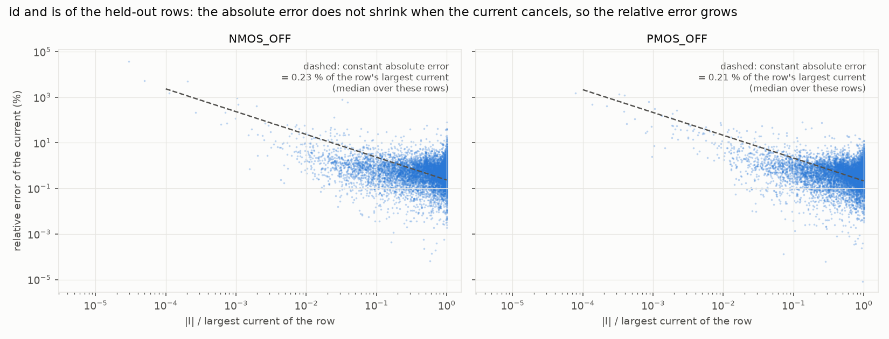

# Error analysis — NMOS_OFF

Section for the "Error analysis" part of the report. Setup: model file `45nm_MGK.pm`, nominal VDD 0.9 V, 20,000 samples per case, random
80 / 10 / 10 split with seed 12175305, MLP (25 inputs → 128-64-32-16 → 4 outputs, SiLU) predicting `log10 |I|` of `id, ig, is, ib`.
Every number below is reproduced by `ML_Models/Results/nmos_off_study.ipynb` (training runs: `ML_Models/Scripts/run_offstudy.py`).

> **Final models.** This analysis was made on the earlier models of the training notebooks (MSE loss; "official" below). Its
> outcome, the Huber loss (section 4.1), made the Huber MLPs the final models: `ML_Models/Saved_Models/<case>.pt`, evaluated in
> `ML_Models/Results/model_evaluation.ipynb`. Sections 1 – 3 describe the earlier NMOS_OFF model; the cause they identify (near-cancelled
> currents) is the same for the final model. Sections 4.1 and 5 describe the Huber models of the follow-up study (test median 0.13 %,
> 95th percentile 0.99 %, mean 5.73 %, set by the row 13855). After the gate-level evaluation (Part B) all four models were re-trained with
> 4,000 extra rows each from the region where the transistor operates inside gates (`ML_Models/README.md`, "Final models"); for NMOS_OFF
> that gives test median 0.24 %, 95th percentile 1.94 %, mean 3.57 % (the same row 13855 now has error 1.7e4 % instead of 3.9e4 %), and
> halves the gate-level error (Part B median 0.34 % → 0.18 %). The extra rows are not drawn from the section 4 distribution and were
> chosen after looking at the gate-level results; the report should say so.

## 1. What needs explaining

| Current (NMOS_OFF, test set, 2,000 rows) | Median error | 95th percentile | Mean error | Mean \|I\| (A) | Mean absolute error (A) | Absolute error / mean \|I\| |
|---|---|---|---|---|---|---|
| `id` | 0.55 % | 3.58 % | 4.83 % | 7.0e-9 | 6.5e-11 | 0.93 % |
| `ig` | 0.38 % | 1.97 % | 0.75 % | 8.0e-9 | 3.7e-11 | 0.46 % |
| `is` | 0.54 % | 3.26 % | 20.29 % | 7.0e-9 | 6.5e-11 | 0.93 % |
| `ib` | 0.11 % | 1.60 % | 0.80 % | 1.1e-14 | 5.8e-17 | 0.53 % |
| average | **0.40 %** | **2.60 %** | **6.67 %** | | | |

Typical accuracy is high and equal to PMOS_OFF (median 0.36 %, 95th percentile 2.13 %). The high mean error (6.67 %, against 1.30 % for
PMOS_OFF) is caused by `id` and `is` only; it is not typical accuracy. In amperes the model is off by 65 pA on average for `id` and `is`
(currents of about 7 nA), i.e. 0.9 % of the current, 0.76 % over all four currents weighted by their size.
A change of the training loss (section 4.1, Huber instead of MSE) lowers the typical error of every case: the NMOS_OFF median falls from 0.40 % to 0.13 %
and the 95th percentile from 2.6 % to about 1.0 – 1.2 %, while the mean stays at 3 – 6 % because of one row that no model fits (section 2.3).

## 2. Why the mean is high

**2.1 `id` and `is` are small differences of large terms.** The three leakage mechanisms of an OFF NMOS act at the source / drain terminals
as follows: the sub-threshold (channel) current enters at the drain, leaves at the source; the gate-tunnelling and junction (body) leakage enter at
both. At the terminal with the *lower* potential the channel current leaves and the gate and junction leakage enter, so its net current is
`I_net = |I_other terminal| − ig − ib`, the difference of two positive terms of similar size (the course slides draw the same directions).
In the data, `ig` and `ib` never change sign. `id` and `is` change sign in 29 % of the rows in which they are the lower-potential
terminal, and never at the other terminal. All rows in which a current is below 1 % of the largest current of its row (265 for `id`, 213 for `is`,
1.2 % of the values) are of this kind (265 / 265 and 213 / 213). They have a low source voltage (0.13 V on average, 0.30 V for all rows), a large
|Vds| (0.55 V against 0.30 V) and are on average at 20 – 24 °C (all rows 42 °C): the conditions in which the channel current is comparable to the gate leakage.

**2.2 The absolute error is constant, so the percentage error is not.** If the network predicts each large term with a fixed fraction of its size,
the error of the difference is that fraction times the *large* term, and the percentage error of the difference grows as (large term) / (net current).
This is what is observed (held-out rows, 4,000; `id` and `is` pooled). In every bin below 50 % the median absolute error is 0.04 % – 0.13 % of the largest current of the row (over all rows the median is 0.23 %); it does not grow as |I| shrinks,
while the percentage error grows by three orders of magnitude:

| \|I\| / largest current of the row | pairs | median error | mean error |
|---|---|---|---|
| 50 – 100 % | 4,612 | 0.52 % | 0.96 % |
| 10 – 50 % | 2,451 | 0.52 % | 0.89 % |
| 1 – 10 % | 859 | 0.94 % | 4.0 % |
| 0.1 – 1 % | 68 | 6.8 % | 40 % |
| < 0.1 % | 10 | 876 % | 9,195 % |

**2.3 The mean is not a stable statistic.** Because the error grows as 1 / |I| near a sign change, a few rows decide the mean. Resampling 2,000 rows
(a test-set size) with replacement from the 4,000 held-out rows gives an NMOS_OFF `id` mean between 2.0 % and 46 % (5th and 95th percentile, median 7.7 %),
an `is` mean between 1.1 % and 39 %, while the median error stays within 0.54 % – 0.60 % (`id`). The 6.67 % of the test set is one draw from such a distribution. The
worst two held-out rows (errors of 41,230 % and 38,235 %) alone make the mean of the lowest-VDD bin 42 %; without them it is 1.3 %. If the absolute error is constant near
a sign change and the net current has a finite density there, the expectation of the percentage error does not even converge (it diverges logarithmically at I = 0).
The worst NMOS_OFF test row is such a case: SPICE `is` = 1.6e-13 A, model 6.0e-11 A, an error of 38,000 %, but only 60 pA, which is 1.1 % of the 5.3 nA of that row's largest current.

**2.4 NMOS_OFF against PMOS_OFF.** The mechanism is the same: the PMOS_OFF `id` and `is` also change sign (30 % of the rows at the higher-potential terminal, the effective source of a PMOS),
and its median and 95th percentile are the same as those of NMOS_OFF. The number of deep dips is also similar (46 and 47 values below 0.1 % of the largest current in the
20,000 rows); NMOS_OFF has 1.5× more values below 1 % (478 against 310) and its deepest values are deeper (smallest |id| 2.9e-15 A against 4.7e-14 A; 7 against 4 values below 0.01 %).
PMOS_OFF's bootstrap range for the `id` mean is narrower (1.3 % – 4.2 %). The difference between the two means therefore comes from the extreme tail, not from a
different typical accuracy.

**2.5 Where, by operating condition (held-out rows, `id` and `is`).** The *median* error is 0.47 % – 0.65 % in every temperature, W / L, vth0 and VDD bin; it only
rises where the current is cancelled (1.0 % when the lower of vd, vs is below 0.1 V, with a 95th percentile of 7 %). Near-cancelled rows are 2 – 3× more frequent below 40 °C
than above (1.4 % against 0.5 % – 0.65 % of the values), absent when the lower terminal voltage is above 0.3 V, and independent of W / L and of vth0 (both scale the terms alike). The
mean per bin (2 % – 42 %) shows only which bin contains the deepest rows.

## 3. Size of the error in amperes

For the test set (2,000 rows) the mean absolute errors of NMOS_OFF are 65 pA (`id`), 37 pA (`ig`), 65 pA (`is`) and 0.06 fA (`ib`); the median absolute errors are 8.7 pA,
12 pA, 9.5 pA and 0.01 fA; the largest is 6.6 nA (`is`), in the row with the highest leakage (118 °C, largest current 226 nA, an error of 3.8 %), not in a cancelled row. The 6.67 % mean error is therefore not a measure of how many amperes are
mis-estimated: weighted by current, the error is 0.76 % (0.93 % for `id` and `is`, 0.46 % for `ig`). The corresponding values of PMOS_OFF are 0.71 % and 52 pA (`id`); of NMOS_ON 0.19 % and 0.2 µA (`id`, currents of 0.1 mA).

## 4. Attempts to reduce the error

### 4.1 A Huber loss instead of MSE (the change that helped)

The networks are trained on `log10 |I|` with a mean-squared-error loss. The few hundred near-cancelled rows have a log10 error of several decades (the target dives and the network cannot follow it);
under MSE their weight grows with the square of that error, and the epoch that is kept (lowest validation MSE) is also decided by them. A Huber loss (quadratic for log errors below a transition width β, in standardized units, linear above)
limits their influence. Nothing else changes (network, features, split, optimizer, 3000 epochs). Test set, NMOS_OFF, one value per training seed:

| Loss | Median error | 95th percentile | Mean error |
|---|---|---|---|
| MSE (reference), seeds 305 / 306 / 307 | 0.40 / 1.08 / 0.62 % | 3.0 / 5.5 / 3.8 % | 6.9 / 7.1 / 10.4 % |
| Huber β = 0.2, seeds 305 / 306 | 0.31 / 0.38 % | 2.0 / 2.4 % | 5.0 / 4.1 % |
| β = 0.1 | 0.44 / 0.36 % | 2.6 / 1.9 % | 5.5 / 5.2 % |
| β = 0.05, seeds 305 / 306 / 307 | 0.25 / 0.32 / 0.27 % | 1.5 / 2.0 / 1.6 % | 3.9 / 3.6 / 3.3 % |
| β = 0.02 | 0.22 / 0.27 % | 1.3 / 1.6 % | 5.5 / 3.0 % |
| β = 0.01 | 0.17 / 0.18 % | 1.1 / 1.2 % | 4.9 / 3.9 % |
| β = 0.005 | 0.17 / 0.16 % | 1.2 / 1.2 % | 6.7 / 4.1 % |
| β = 0.002 (lowest validation median, chosen) | 0.13 / 0.13 % | 1.2 / 1.0 % | 5.7 / 5.7 % |

* **The typical error falls by a factor of 3 and the seed lottery disappears:** the median of the same network no longer depends on the seed (0.13 % at both seeds for β = 0.002, against 0.35 % – 1.08 % with MSE), and the 95th percentile is 1.0 – 1.2 %.
  A smaller β (closer to an absolute-error loss) lowers the median further; the 95th percentile stops improving below β = 0.01.
* **The mean does not fall, because of one row.** The worst test row is the same in every run, with MSE or Huber: the near-cancelled `is` of SPICE value 1.57e-13 A, predicted 1.9e-11 – 1.0e-10 A (error 1.2e4 – 6.5e4 %). It alone contributes 1.5 – 8 points of the mean error;
  without it the mean is 1.0 – 2.1 % for the Huber runs against 2.3 – 3.2 % for MSE.
* **The other three cases improve too** (β = 0.05, seed 305; notebook model in brackets): PMOS_OFF 0.20 % median, 1.12 % 95th percentile, 0.93 % mean (0.36, 2.13, 1.30 %); NMOS_ON 0.16, 0.85, 0.68 % (0.22, 1.27, 0.77 %); PMOS_ON 0.20, 0.93, 0.47 % (0.35, 1.56, 0.65 %).
* **Not combined with the Kirchhoff term** (β = 0.05, λ = 10: 0.31 / 1.7 / 4.5 % against 0.25 / 1.5 / 3.9 % without it). **Cosine learning-rate decay** with the Huber loss gave 0.21 % / 1.4 % / 2.7 % and 0.22 % / 1.4 %, but in one of the two runs a single
  test row was predicted as 14 A instead of 2e-10 A, a numerical blow-up of that network that did not occur in any of the 15 plain-Huber NMOS_OFF runs; it was not used. The final selection rejects any candidate whose worst validation prediction is off by more than 6 decades.
* **More training data helps, with diminishing returns** (β = 0.002, seed 305, trained on a subset of the training rows): test median 0.33 / 0.22 / 0.14 / 0.13 % and 95th percentile 3.7 / 2.4 / 1.35 / 1.16 % for 4,000 / 8,000 / 12,000 / 16,000 rows. The gain flattens between 12,000 and 16,000 rows, so more than 20,000 samples is unlikely to be the main lever for the typical error (not tested beyond 16,000 rows).
* The structured splits of section 5 and all comparisons of section 4.2 use the MSE loss of the notebooks; they were not repeated with the Huber loss.

Final Huber models (β = 0.002; of the two trained seeds the one with the lower validation median error is kept: NMOS_ON 12175305, NMOS_OFF 12175306, PMOS_ON 12175306, PMOS_OFF 12175305; no candidate had a blown-up prediction). Test set, 2,000 rows, average over the four currents; the ampere-weighted error is Σ|I_pred − I_true| / Σ|I_true|. [`ML_Models/Results/huber_test_results.csv`](../ML_Models/Results/huber_test_results.csv), parity plots of the final models `ML_Models/Plots/parity_<case>.png`.

| Case | Model | R² (log\|I\|) | Median error | 95th percentile | Mean error | Ampere-weighted error |
|---|---|---|---|---|---|---|
| NMOS_ON | official (MSE loss) | 0.9997 | 0.22 % | 1.27 % | 0.77 % | 0.19 % |
| NMOS_ON | **Huber loss** | 0.9997 | 0.10 % | 0.62 % | 0.58 % | 0.08 % |
| NMOS_OFF | official (MSE loss) | 0.9852 | 0.40 % | 2.60 % | 6.67 % | 0.76 % |
| NMOS_OFF | **Huber loss** | 0.9923 | 0.13 % | 0.99 % | 5.73 % | 0.35 % |
| PMOS_ON | official (MSE loss) | 0.9998 | 0.35 % | 1.56 % | 0.65 % | 0.36 % |
| PMOS_ON | **Huber loss** | 0.9998 | 0.09 % | 0.60 % | 0.31 % | 0.08 % |
| PMOS_OFF | official (MSE loss) | 0.9921 | 0.36 % | 2.13 % | 1.30 % | 0.71 % |
| PMOS_OFF | **Huber loss** | 0.9964 | 0.12 % | 0.86 % | 0.85 % | 0.25 % |

The median error falls by 2.3× (NMOS_ON) to 3.7× (PMOS_ON), the 95th percentile by 2.1× to 2.6×, the ampere-weighted error by 2.2× to 4.7×; the mean of NMOS_OFF (5.73 %) is still set by the one near-cancelled row of section 2.3 (its `is` mean is 20.1 %, 20.3 % for the official model; its `id` mean falls from 4.8 % to 2.3 %).

### 4.2 Changes that did not help

All runs use the same network, optimizer and 80 / 10 / 10 split. "Sum err" is Σ|I_pred − I_true| / Σ|I_true| over the four currents (the ampere-weighted error).

| Attempt (test set) | Median | 95th | Mean | Sum err | Outcome |
|---|---|---|---|---|---|
| Chosen model: MLP + Kirchhoff loss, `log10 \|I\|` target | 0.40 % | 2.60 % | 6.67 % | 0.76 % | reference |
| Plain MLP, 5 training seeds, trained 3000 epochs | 0.35 – 1.08 % | 2.6 – 5.5 % | 6.4 – 11.2 % | 0.65 – 1.65 % | the seed alone moves the median 3× |
| Ensemble of those 5 (geometric mean) | 0.35 % | 2.2 % | 7.5 % | 0.59 % | equals the best seed; the mean does not fall |
| Signed-log target `sign(I)·log10(1 + \|I\|/I0)` for `id`, `is`; I0 = q-quantile of \|I\|: q = 0.001 / 0.01 / 0.2 | 4.0 / 3.5 / 2.3 % | 21 / 18 / 17 % | 6.9 / 7.2 / 20 % | 7.2 / 5.6 / 3.6 % | worse |
| … q = 0.05 (best on validation), 3 seeds | 1.20 / 4.61 / 0.62 % | 8.4 / 24 / 5.3 % | 3.8 / 15 / 8.5 % | 2.4 / 6.9 / 1.1 % | lowers the mean in one seed only; median 3× higher in it |
| Derive the cancelling current from Kirchhoff's law (`−(other terminal + ig + ib)`) | 0.36 % of the row's largest current (median absolute error) against 0.13 % for the direct prediction | | | | 3× worse |
| Bigger network 256-128-64-32 / 256-256-128-64 | 0.88 / 0.44 % | 4.8 / 4.9 % | 14 / 45 % | 1.4 / 1.3 % | no gain |

*Interpretation.* The signed-log target removes the logarithmic dive of the target at I = 0, but it places the sign change of `id` / `is` as a steep step in the target (when I0 is
small compared with the currents) that the network fits badly: the training median error of those models is 1.1 % – 4.6 % against 0.35 % for the plain target, the
absolute error of `id` is 2 – 15× larger, and 0.1 % – 1.0 % of the signs are wrong. For a larger I0 the target is smoother, but the currents below I0 are then no longer
resolved in relative terms. In these runs the percentage error of a cancelled row is limited by the absolute accuracy of the network on the large terms (of the order of 0.1 % – 0.3 % of the largest
current), which a change of target does not improve. What did help was a loss that fits the bulk of the rows better (section 4.1), which lowers that absolute error everywhere.

## 5. Behaviour on held-out widths and temperatures

The assignment's random split puts every width and temperature in training. To see what the models do on conditions they were not trained on, the data was also split by
W / L (L is fixed at Lmin, so W / L = 1 – 8) and by temperature: held-out W / L bands, held-out 10 °C windows around 27 °C and 85 °C, extrapolation to W / L 7 – 8 and to 105 – 125 °C, a 4 × 4 grid of W / L × T
blocks with the combination unseen, and the wide-and-hot corner (W / L ≥ 7 and T ≥ 105 °C, trained on W / L < 6 and T < 85 °C). Validation and test sets come from different bands, the same network and
settings are used, and every OFF run trains 3000 epochs (the best validation epoch is kept). Test median / 95th percentile error, average over the four currents:

| Held-out set | NMOS_OFF | NMOS_OFF, signed-log target | PMOS_OFF | NMOS_ON | PMOS_ON |
|---|---|---|---|---|---|
| random 10 % (assignment split) | 0.40 / 2.6 % | 1.2 / 8.4 % | 0.36 / 2.1 % | 0.22 / 1.3 % | 0.35 / 1.6 % |
| W / L bands [3, 3.5), [6, 6.5) | 0.52 / 3.1 % | 2.6 / 16 % | 1.28 / 5.3 % | 0.91 / 3.2 % | 0.37 / 1.5 % |
| W / L 7 – 8 (trained on < 6) | 0.72 / 5.2 % | 5.0 / 24 % | 1.47 / 7.0 % | 1.24 / 5.7 % | 0.46 / 2.1 % |
| 10 °C windows around 27 and 85 °C | 1.98 / 9.2 % | 4.9 / 20 % | 0.51 / 2.6 % | 0.65 / 2.9 % | 0.23 / 1.2 % |
| T ≥ 105 °C (trained on < 85 °C) | 14.2 / 42 % | 15.0 / 47 % | 16.6 / 54 % | 0.52 / 3.9 % | 0.63 / 3.4 % |
| 2 of 16 W / L × T blocks | 4.6 / 17 % | 2.8 / 16 % | 0.94 / 4.1 % | 0.65 / 2.6 % | 0.26 / 1.2 % |
| W / L ≥ 7 and T ≥ 105 °C (361 rows) | 20.9 / 55 % | 19.8 / 71 % | 24.2 / 47 % | 2.4 / 11 % | 0.92 / 4.7 % |

Figure: [`ML_Models/Plots/offstudy_splits.png`](../ML_Models/Plots/offstudy_splits.png) (the splits), [`ML_Models/Plots/nmos_off_structured_splits.png`](../ML_Models/Plots/nmos_off_structured_splits.png) (results).
The random-split row of the OFF columns is the saved model of the training notebooks (Kirchhoff loss), the other plain-target entries are runs of `offstudy.py` (no Kirchhoff loss); the signed-log column is one seed.
The ON columns use the notebooks' early stopping (patience 300), not the 3000 epochs of the OFF columns.

* **Interpolation is not measurably worse than the random split.** One seed suggested that the temperature windows are 5× harder (1.98 %). With three seeds the medians are 1.98 / 0.64 / 0.51 % (T windows) and 0.52 / 1.97 / 0.52 % (W / L bands),
  against 0.35 – 1.08 % for the random split: the seed-to-seed spread is as large as the difference. The single-seed entries in the table (e.g. PMOS_OFF 1.28 % on the W / L bands) must be read with that spread in mind.
* **Widths extrapolate** (NMOS_OFF 0.72 %), the log-width feature carries over: the currents are proportional to W.
* **Temperature does not extrapolate for the OFF cases:** 14 % (NMOS_OFF) and 17 % (PMOS_OFF) at 105 – 125 °C and 21 % / 24 % in the wide-and-hot corner, against 0.5 % – 0.6 % and 0.9 % – 2.4 % for the ON cases.
  For NMOS_OFF at ≥ 105 °C the median error is 5.2 % (`id`), 4.0 % (`ig`), 6.4 % (`is`) and 41 % (`ib`) (PMOS_OFF: 5.3, 4.3, 5.3, 52 %). `id`, `ig` and `is` are unbiased (median log10 error within ±0.012) but scattered, about 10× more than on the random split.
* **The `ib` failure is a regime the training data does not contain.** In both OFF cases the body current is a flat 1.0e-14 A up to about 85 °C and rises only above about 90 °C (NMOS_OFF median 1.04e-14 A at 85 – 95 °C, 1.4e-14 A at 105 – 115 °C, 2.2e-14 A at 115 – 125 °C).
  A model trained below 85 °C has never seen the rise and predicts the flat value, which is the observed under-prediction (0.74× of the true value at 105 – 110 °C, 0.40× at 120 – 125 °C). It is not a trend that the network fails to continue. The ON currents
  extrapolate because they depend weakly on T (`id` changes by 0.1 – 0.3 decades over −40 … 125 °C) or smoothly (the ON `ib` rises by two decades and is extrapolated within 0.7 % – 0.8 %). `ib` is about 2e-6 of the other currents in an OFF transistor.
* **The signed-log target** is worse than the plain target on the random split, the W / L bands and the temperature windows, about equal on the two temperature-extrapolation splits, and better only on the block split (2.8 % against 4.6 %, one seed).

## 6. Consequences and possible improvements

* **What the metric means.** The assignment's transistor-level measures are the median and the 95th percentile; for NMOS_OFF they are 0.40 % and 2.60 %. The mean error of
  a signed current that crosses zero is dominated by a few rows and should be quoted together with the ampere-weighted error (0.76 %).
* **Gate level (not yet evaluated).** Whether a badly predicted, strongly cancelled `id` / `is` matters depends on how the terminal currents are summed into the gate
  leakage: the absolute error of such a row is small (0.04 % – 0.26 % of the largest current in it), so a sum over the supply-side currents should inherit roughly the ampere-weighted level (0.76 % for the official NMOS_OFF model, 0.35 % for the Huber model), not the percentage of the cancelled row.
* **Recommended (done):** train all four models with the Huber loss (section 4.1; these are now the final models, `ML_Models/Saved_Models/<case>.pt`) and choose among candidates by the validation median and 95th percentile and a check for blown-up predictions, not by the validation mean.
* **Untested improvements:** (1) more samples, or a loss weight, at low source voltage (< 0.3 V) and below 40 °C, where the cancellation happens; (2) an ensemble of Huber-trained models; (3) predicting the sign-definite terms (the large current and `ig`) and the sign / ratio of the
  net current with a model whose loss is in amperes relative to the row's largest current; (4) the structured splits with the Huber loss.
* **Limits of this study:** one split, one network family, a training seed that alone changes the median by 3×; differences smaller than that between single runs are not conclusive.
